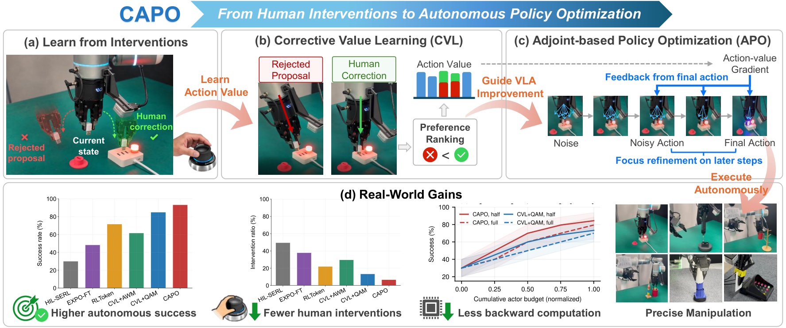
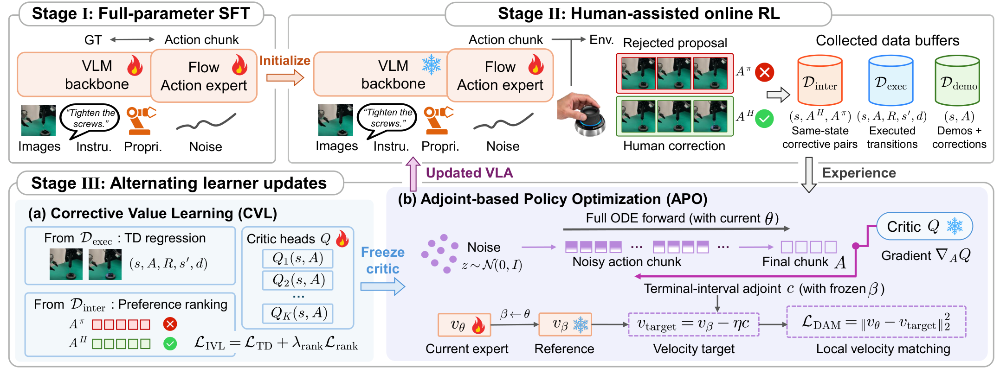

<div align="center">

# CAPO

**Real-World Reinforcement Learning for VLA via Corrective Adjoint Policy Optimization**

[Project Page](https://fvl-repo.github.io/CAPO-Website/) · [Method](#method) · [Setup](#setup) · [Contact](#contact)

</div>

[](docs/figures/teaser.pdf)

<p align="center"><b>CAPO</b> turns human corrective experience into informative action values and uses this guidance to improve the VLA’s native flow policy.</p>

## Abstract

Human-in-the-Loop Reinforcement Learning (HiL-RL) offers a practical route for adapting Vision-Language-Action (VLA) models through real-world interaction guided by human interventions. Yet effectively leveraging these interventions remains challenging, their corrective signals must first support informative value learning and then be translated into effective updates of the VLA’s multi-step flow policy. To address these challenges, we propose **Corrective Adjoint Policy Optimization (CAPO)**, a real-world RL framework that couples **Corrective Value Learning (CVL)** with **Adjoint-based Policy Optimization (APO)**. Specifically, CVL exploits human corrections both to learn action values from their observed outcomes and to provide comparative supervision against rejected policy proposals. Guided by the learned critic, APO propagates action-value gradients along the VLA’s native flow trajectories and converts them into local policy updates, while preserving the original deployment sampler. Across six real-world manipulation tasks, CAPO achieves the highest mean autonomous success of 93.3% and the lowest intervention rate among the evaluated methods.

## Method

CAPO starts from a task-adapted VLA, collects human-assisted experience, and alternates critic learning with updates to the flow action expert.

[](docs/figures/method.pdf)

- **Corrective Value Learning (CVL).** Combine temporal-difference learning on executed transitions with preference ranking between human corrections and the policy proposals they replace.
- **Adjoint-based Policy Optimization (APO).** Carry action-value gradients backward along native flow trajectories to construct local velocity targets, with a phase-wise reference and terminal-interval matching.
- **Native policy deployment.** Retain the original VLA sampler without an auxiliary actor or inference-time critic guidance.

| Component | Implementation |
| --- | --- |
| Critic, TD targets, and corrective preference ranking | [value.py](src/capo/value.py) |
| Flow rollout, adjoint targets, and velocity matching | [adjoint.py](src/capo/adjoint.py) |
| Alternating CVL / APO updates | [trainer.py](src/capo/trainer.py) |
| Human-assisted collection and online workflow | [collect.py](src/capo/collect.py), [workflow.py](src/capo/workflow.py) |
| OpenPI π₀.₅ backbone and expert adaptation | [backbone.py](src/capo/backbone.py), [lora.py](src/capo/lora.py) |

This repository provides CAPO with an OpenPI π₀.₅ backbone, expert LoRA, and a Flexiv interface. All model image inputs are 224 × 224. See [training design](docs/method.md) for implementation choices and configuration details.

## Setup

Training and robot control use separate environments:

| Environment | Dependency specification | Installation |
| --- | --- | --- |
| Training / inference host | [pyproject.toml](pyproject.toml), including the `pi05` extra | `bash scripts/setup.sh` |
| Flexiv robot host | [requirements-flexiv.txt](requirements-flexiv.txt) | `python -m pip install -r requirements-flexiv.txt` |

The robot host runs hardware and camera interfaces without Torch, JAX, or OpenPI. Follow [robot integration](docs/robot.md) to configure it separately.

On the training host, use Python 3.11 or 3.12 and run commands from the repository root:

```bash
bash scripts/setup.sh
source .venv/bin/activate
python scripts/download_assets.py
```

Setup installs the required OpenPI patches for Transformers 4.53.2. The download script provides the tokenizer and pretrained ResNet-10.

Follow [OpenPI](https://github.com/Physical-Intelligence/openpi#pre-trained-models) to download `pi05_base` into `assets/openpi_pi05_base_jax`, then convert it:

```bash
python scripts/convert_jax_checkpoint.py \
  --input assets/openpi_pi05_base_jax --output assets/openpi_pi05_base
```

Alternatively, place a compatible OpenPI PyTorch checkpoint at `assets/openpi_pi05_base/model.safetensors`. Keep assets, datasets, and outputs inside this checkout.

## 1. Expert data and SFT

Follow [OpenPI's fine-tuning guide](https://github.com/Physical-Intelligence/openpi#fine-tuning-base-models) for camera mapping, action conventions, and task-specific normalization. Configure:

| Config | Purpose |
| --- | --- |
| `configs/robots/flexiv.yaml` | Robot/camera IDs, workspace, reset pose, teleoperation, task |
| `configs/workflow/dataset.yaml` | Adapter, data paths, task, normalization |
| `configs/workflow/sft.yaml` | Base weights, dimensions, horizons, LoRA, batch size, schedule |

Start the [robot server](docs/robot.md), then collect and prepare demonstrations:

```bash
export CAPO_FLEXIV_URL=http://127.0.0.1:8766
python -m capo.demonstrations collect --config configs/workflow/dataset.yaml --episodes 20
python -m capo.demonstrations prepare --config configs/workflow/dataset.yaml
torchrun --standalone --nproc-per-node=8 -m capo.sft \
  --config data/demonstrations/prepared/data_config.json
```

`prepare` computes normalization with OpenPI's `RunningStats`. Add `--existing-norm` to reuse matching task statistics. Existing demonstrations can use the [NPZ format](docs/data.md).

SFT reads offline demonstrations and writes `runs/sft/sft.pt` and `runs/sft/config.json`. The template uses global batch 256, microbatch 32 per GPU on eight GPUs. Adjust these for your hardware.

## 2. Reward model (optional)

Prepare [binary-labeled image episodes](docs/data.md#reward-labels), then configure data paths and training settings in `configs/workflow/reward.yaml`:

```bash
python -m capo.reward_train --config configs/workflow/reward.yaml
```

Set `enabled: true` to use the classifier, or `false` for manual success labeling. Rewards are -0.05 per step and 10 for success.

## 3. Online RL

Configure `configs/workflow/online.yaml` with the SFT configuration/checkpoint, matching normalization, robot adapter, reward config, and update budgets:

```bash
python -m capo.workflow --config configs/workflow/online.yaml
```

Each round collects transitions, updates the critic with CVL and the actor with APO + BC, then publishes the actor. Re-run the same command to resume.

Flexiv uses `CAPO_FLEXIV_URL` and `configs/robots/flexiv.yaml`. Other robots plug in through the YAML `adapter: package.module:create` field, see [robot integration](docs/robot.md).

## 4. Policy serving and export

Serve a saved actor with the matching training configuration and normalization:

```bash
python -m capo.serve --config runs/sft/config.json \
  --checkpoint runs/sft/sft.pt --norm-stats assets/task/norm_stats.json
```

Use the corresponding configuration and actor checkpoint for an online-trained policy. The service returns action chunks over WebSocket, robot execution remains in the robot adapter.

To merge the trained actor into a standalone OpenPI weight file:

```bash
python scripts/export_policy.py --checkpoint runs/sft/sft.pt --output assets/capo_export
python -m capo.serve --config assets/capo_export/capo_config.json \
  --norm-stats assets/task/norm_stats.json
```

Set `device` in the exported configuration to `cuda` for GPU inference. Use your task's normalization path in both commands.

## Acknowledgments

Thanks to [OpenPI](https://github.com/Physical-Intelligence/openpi) for the backbone, [VLA-Precision](https://github.com/scy-v/VLA-Precision) for the critic/training reference, [QAM](https://github.com/ColinQiyangLi/qam) for adjoint matching, [SERL](https://github.com/rail-berkeley/serl) for the encoder, and HIL-RL for robot and reward workflow references.

[Apache-2.0](LICENSE). Upstream terms remain applicable: [critic reference](third_party/licenses/VLA_PRECISION_LICENSE), [adjoint reference](third_party/licenses/QAM_LICENSE), [encoder](third_party/licenses/SERL_LICENSE), [robot integration](src/capo/robots/THIRD_PARTY_LICENSE), and [third-party notices](THIRD_PARTY.md).

## Contact

Maintained by [zgj77](https://github.com/zgj77) in [FVL-Repo](https://github.com/FVL-Repo).

For questions about CAPO, please contact **Guojin Zhong** at [gjzhong25@m.fudan.edu.cn](mailto:gjzhong25@m.fudan.edu.cn).
